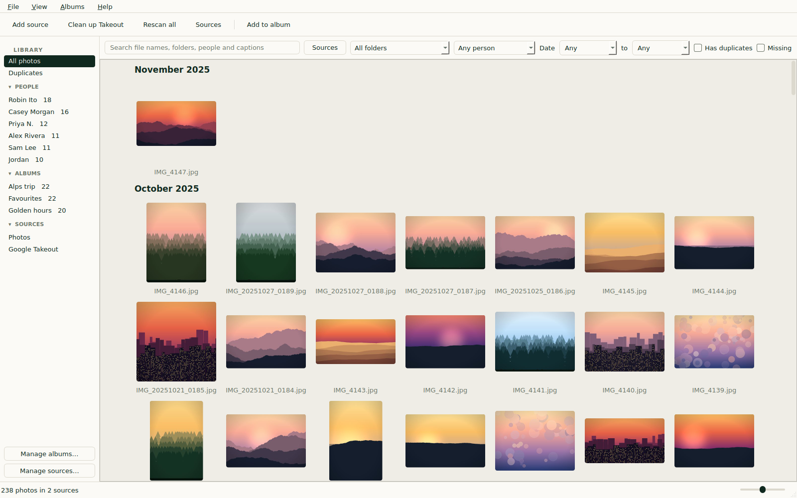

<p align="center"></p>

<p align="center">
  <a href="https://imagory.mshahnawaz.me">Website</a> ·
  <a href="https://imagory.mshahnawaz.me/download">Download</a> ·
  <a href="https://imagory.mshahnawaz.me/changelog">Changelog</a> ·
  <a href="https://github.com/Mshahnawaz1/Imagory/issues/new">Report a bug</a>
</p>

# Imagory


**A fast, private photo library for the photos on your own computer, and the easiest way to
leave Google Photos with your memories intact.**

Imagory is a free, open source desktop app for Windows (and Linux). Point it at your photo
folders and your Google Takeout export, and get one fast, browsable library: newest first,
with dates, places, albums, and people, all without an internet connection.

<p align="center">
  <picture>
    <source media="(prefers-color-scheme: dark)" srcset="frontend/src/assets/screenshots/main-dark.png">
    
  </picture>
</p>

> **Your photos stay yours.** Imagory is fully offline.
>
> - **No network connections:** no telemetry, no accounts, no update checks.
> - **Read-only:** it never changes, moves, renames, or deletes your photos in the original folder.
>   into your photo folders.
> - **Local data only:** the database, thumbnails, and logs stay on your computer in Imagory's
>   own library folder.
> - **Clean up Takeout:** writes copies into an output folder you pick removing duplicates and creating cleaner alternative of google photos takeout. Original folders deletion is left to users preferences.

Website and user guide: [imagory.mshahnawaz.me](https://imagory.mshahnawaz.me)

## What is Imagory for?

### 1. Browsing and organising your local photos

Years of phone backups, camera dumps, and old drives end up scattered across folders.
Add each folder to Imagory as a **source** and see everything in one grid, sorted by the date
each photo was actually taken.

- **Real dates:** from the photo's EXIF data, then the file name (such as
  `IMG_20190131_235959`), then the file's modified time.
- **Duplicates shown once:** the same photo in three backup folders appears a single time.
- **Search and filter:** by file name, folder, person, or caption, and by date, source,
  folder, or person.
- **Moved a folder or plugged the drive into a new letter?** Point the source at its new place
  without a full rescan. Photos that go missing are hidden, not forgotten.

### 2. Moving away from Google Photos

Google Takeout gives you your photos, but the details live in a separate JSON file next to
each one. Most photo apps ignore those files, so your dates, albums, and people are lost.
Imagory reads them, so a Takeout export opens the way it looked in Google Photos:

- **Dates taken**, even when the file's own date is just the time you unzipped the export.
- **Locations** (the GPS position saved in Google Photos), shown in the photo's info panel.
- **Albums**, rebuilt in the sidebar from the album folders in the export.
- **People's faces from Google Photos:** the face groups you named in Google Photos come
  across as people you can browse and filter by. Imagory uses Google's people data as it is
  in the export; it doesn't run face recognition itself.
- **Captions and favourites.**

### 3. Cleaning up a Google Takeout export

A raw Takeout export is messy: a JSON file next to every photo, the same photo copied into
several album folders, truncated file names, and meaningless file dates. **Clean up Takeout**
turns it into a tidy folder you'd be happy to keep:

- **One copy of each photo or video**, sorted into `YYYY/MM` folders by the date taken.
- **The original file names** from Google Photos, not the truncated ones.
- **No JSON clutter.** All the metadata (dates, places, people, captions, favourites, albums)
  is kept in Imagory's database inside the output folder, plus a plain-text `metadata.json`
  you can read without Imagory.
- **Every copy is verified** against the original before it counts as done, and Imagory tells
  you when the original export is safe to delete. (Deleting it is up to you; Imagory never
  does it.)

### It's fast

Imagory is built for big libraries. Measured on a library of 100,000 photos:

| | Time |
|---|---|
| First full scan (Windows 11) | about 10 minutes, and you can browse while it runs |
| Rescan when nothing changed | about 5 seconds |
| First screen of thumbnails after opening the app | under 1 second |

Scrolling stays smooth through all 100,000 photos. Scans run in the background, can be
cancelled at any time, and carry on where they stopped.

## Get started in three steps

1. **Install** Imagory (below). There is no installer: it's a single file you double-click.
2. Click **Add a folder…** and pick a photo folder or an **extracted** Google Takeout folder.
   Imagory detects which kind it is. Photos appear while the scan runs.
3. Browse. Double-click a photo to view it, use **Left** and **Right** to move between photos,
   and press **Esc** to return to the grid.

Leaving Google Photos? Download your export from
[takeout.google.com](https://takeout.google.com), **extract the zip files** (Imagory doesn't
read zips yet), then either add the folder as a source or run **Clean up Takeout…** first to
get a tidy copy. See [Cleaning up a Google Takeout export](#cleaning-up-a-google-takeout-export).

Supported formats: JPEG, PNG, GIF (first frame), and HEIC/HEIF. Videos are not shown in the
grid yet, but **Clean up Takeout** copies them safely along with your photos.

## Install

There are two ways to get Imagory on Windows. Pick one.

| | Option A: download the `.exe` | Option B: build it yourself |
|---|---|---|
| Time | 1 minute | About 10 minutes |
| Needs | Nothing | Git and uv |
| SmartScreen warning | Yes, on first run | No |

### Option A: download the `.exe` (Windows)

1. Download `Imagory.exe` from the [releases page](https://github.com/Mshahnawaz1/Imagory/releases).
2. Double-click it. There is no installer.
3. If Windows shows **"Windows protected your PC"**, click **More info**, then **Run anyway**.

The warning appears because releases are not code-signed. Some antivirus tools also flag
unsigned single-file programs built with PyInstaller. If you'd rather not trust the download,
use Option B.

### Option B: build it yourself (Windows)

SmartScreen only checks files downloaded from the internet. An `.exe` you build on your own
PC is not marked as downloaded, so the warning does not appear. An antivirus tool may still
ask about any unsigned program.

You need [Git for Windows](https://git-scm.com/download/win). Run these in PowerShell:

```powershell
# 1. Install uv (one time), then open a new terminal
powershell -ExecutionPolicy ByPass -c "irm https://astral.sh/uv/install.ps1 | iex"

# 2. Get the code
git clone https://github.com/Mshahnawaz1/Imagory.git
cd Imagory

# 3. Build
uv sync
uv run pyinstaller --noconfirm --clean imagory.spec
```

The result is `dist\Imagory.exe`. Move it anywhere and double-click it.

- uv downloads Python 3.12 for you if it isn't installed.
- Build on real Windows, in a Windows folder. A WSL build makes a Linux program, not an `.exe`.
- To update later: `git pull`, then repeat step 3.

More detail and troubleshooting: [docs/setup.md](docs/setup.md).

### Linux

Download `Imagory-<version>-linux-x86_64.tar.gz` from the
[releases page](https://github.com/Mshahnawaz1/Imagory/releases), then:

```sh
tar -xzf Imagory-0.2.0-linux-x86_64.tar.gz
./Imagory-0.2.0-linux-x86_64/Imagory
```

- Runs on Ubuntu 22.04 or newer (x86_64) and other distros of the same age.
- Needs a desktop with X11 or XWayland.
- If it doesn't start, install Qt's system libraries:
  `sudo apt install libxcb-cursor0 libxkbcommon-x11-0 libegl1`
- Windows is the main platform. The Linux build has had less testing, and **Show in folder**
  opens the folder without selecting the photo.
- To build it yourself, see [docs/setup.md](docs/setup.md).

## Using Imagory

### Adding and browsing photos

1. **Add a folder:** click **Add a folder…** and give the source a label, such as "Phone
   backup". Imagory detects whether it is a Takeout export; you can change the type.
2. **Browse:** photos appear in the grid, newest first with month headers, while the scan runs
   in the background. You can cancel at any time.
3. **Find photos:** use the search box and filters, or pick an album or a person in the
   sidebar.
4. **View:** double-click a thumbnail or press Enter. **Left** and **Right** move between
   photos. Esc returns to the grid. The info panel shows the date, place, people, and file
   details.
5. **Rescan all:** finds new, changed, and missing photos in every source, and carries on
   where a cancelled scan stopped.

### Managing sources

**Sources…** lists your sources with their photo and missing counts.

| Action | What it does |
|---|---|
| **Rescan** | Picks up new, changed, and missing photos in that source |
| **Rename** / **Change type…** | Changes the label, or switches between plain folder and Takeout |
| **Relocate…** | Points a source at its new folder (a moved folder or a new drive letter) without a full rescan |
| **Remove missing…** | Forgets the source's missing files, after you confirm |
| **Remove…** | Forgets the whole source, its thumbnails, and any albums it leaves empty, after you confirm |

None of these touch the photos on disk. A source whose folder is unavailable (an unplugged
drive, for example) is reported, and the other sources are still scanned.

### Cleaning up a Google Takeout export

Open **Clean up Takeout…** (toolbar or File menu), pick the extracted export and an empty
output folder, and follow the wizard. It shows what it will copy and the space needed, and
copies nothing until you click **Start copying**. You can cancel at any time and carry on
later. When it finishes, **Add to library** adds the clean copy as a source, with its albums.

Your original export is never changed, moved, or deleted.

Step-by-step guide: [Takeout cleanup](https://imagory.mshahnawaz.me/docs/takeout-cleanup) on
the website.

### Where Imagory keeps its data

| Platform | Library folder |
|---|---|
| Windows | `%LOCALAPPDATA%\Imagory\` |
| Linux | `~/.local/share/imagory/` (or `$XDG_DATA_HOME/imagory`) |

It contains:

- `imagory.db`: the database
- `thumbs\`: a thumbnail cache you can delete at any time
- `logs\`: open it with **Help > Open log folder**. Logs are never sent anywhere.

A library created by a development build older than 0.2.0 is not carried over. Imagory starts
empty and you add your folders again. Your photos are not affected.

## Want to contribute?

Bug reports, testing on real photo collections, and code are all welcome.

- **Found a bug, or a Takeout export that Imagory reads wrongly?** Please
  [open an issue](https://github.com/Mshahnawaz1/Imagory/issues). Don't attach your own photos;
  describe the file instead.
- **Want to write code?** Read [CONTRIBUTING.md](CONTRIBUTING.md) first. It covers the rules
  every change must follow, setup, test data, and benchmarks. Open work is listed in
  [docs/tasks.md](docs/tasks.md).

### Development

Requires [uv](https://docs.astral.sh/uv/).

```sh
uv sync                                                 # install dependencies into .venv
IMAGORY_LIBRARY=.dev-library uv run python -m imagory   # run with a scratch library
uv run pytest -q                                        # all tests
uv run ruff check . && uv run ruff format --check .     # lint and format check
```

Always set `IMAGORY_LIBRARY` to a scratch folder so your real library is never touched.
Release builds are described in [docs/setup.md](docs/setup.md).

## Documentation

- [PRD.md](PRD.md): scope, architecture, data model, and the decisions log
- [GLOSSARY.md](GLOSSARY.md): the terms used in the code and docs
- [docs/architecture.md](docs/architecture.md): a diagram of the components
- [docs/takeout-cleanup.md](docs/takeout-cleanup.md): the Takeout cleanup design
- [docs/setup.md](docs/setup.md): building on Windows and Linux
- [CONTRIBUTING.md](CONTRIBUTING.md): how to report bugs and contribute changes


## Licence

Imagory is released under the [MIT licence](LICENSE).

- Bundled third-party components keep their own licences, listed in
  [THIRD_PARTY_LICENSES.txt](THIRD_PARTY_LICENSES.txt).
- PySide6/Qt and the HEIC decoder (libheif and libde265, through pi-heif) are used under the
  LGPL v3.
- Release 0.2.0 bundled pillow-heif, which includes the GPLv2 x265 encoder. Later releases use
  the decode-only pi-heif instead (PRD §16).

Made with ❤️ (If read till here, give it a star.)